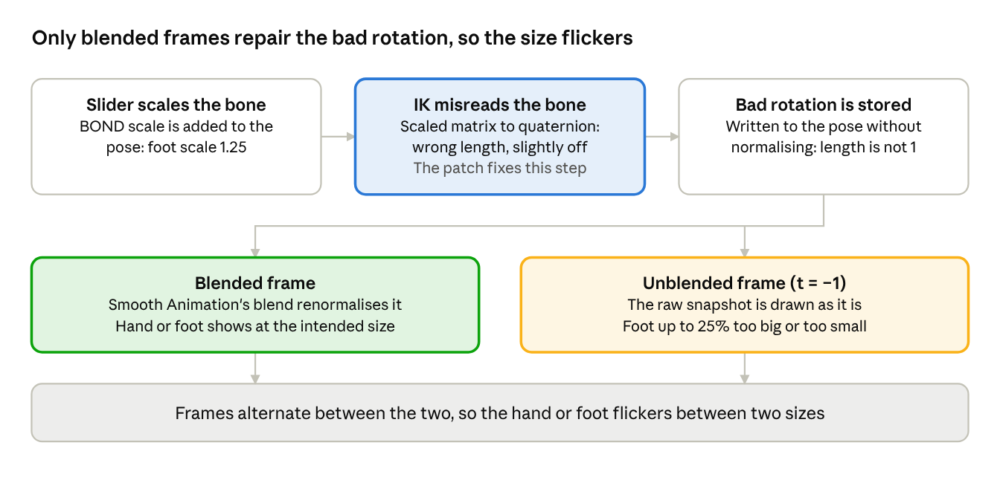

# Limb IK Scale Fix

ASI mod for The Sims 3 that stops sims' hands and feet from flickering between two sizes when hand or foot size sliders are used. Requires an ASI loader.

> **Made with AI.** The research, reverse engineering, code and documentation in this repository were produced by Claude, Anthropic's AI model, in a conversation with me. I directed the work, supplied the game files and test data, and tested the result in game. Details are under [How this was made](#how-this-was-made).

## The problem

With custom sliders that resize hands or feet, such as Sage's Hand Size slider or NikSim's Feet slider, the affected hands or feet flicker rapidly between two sizes. It only happens while the game's limb IK and animation smoothing are both on, which they always are unless you turn them off in [Sims 3 Settings Setter](https://github.com/sims3fiend/Sims3SettingsSetter) (RenderLimbIk and Smooth Animation, under Animation).

The cause is a math bug in the game's limb inverse kinematics solver, and this mod fixes that one step. [docs/TECHNICAL.md](docs/TECHNICAL.md) explains it in full.

## Install

1. Make sure you have an ASI loader in `The Sims 3\Game\Bin`, for example [Ultimate ASI Loader](https://github.com/ThirteenAG/Ultimate-ASI-Loader/releases/latest) or the one that comes with [Smooth Patch](https://modthesims.info/d/658759/smooth-patch-2-1.html).
2. Download the zip from the latest [release](../../releases) and copy `LimbIkScaleFix.asi` into `The Sims 3\Game\Bin`. `LimbIkScaleFix.ini` is optional; it only holds the default settings.
3. Launch the game and open `LimbIkScaleFix.log` in `Game\Bin`. A line starting with `Patched call at` means the fix is active.

To uninstall, delete `LimbIkScaleFix.asi`. The mod doesn't change any files.

The release downloads are built automatically by GitHub from the source code in this repository, so what you download matches the code you can read here.

## Compatibility

| Game version | Status |
| --- | --- |
| EA App / Origin 1.69.47 (`TS3.exe`) | Tested in game |
| Steam 1.67.2 (`TS3W.exe`) | Tested in game |
| Disc 1.67.2 (`TS3W.exe`) | Untested, but expected to work in parity with Steam executable |

Tested on adult, teen and child sims. Toddlers and pets haven't been tested.

It works alongside Sims 3 Settings Setter. If another mod has already hooked the same call, the fix writes that to its log and does nothing.

## Using it

- **Ctrl+Shift+K** turns the fix off and on while the game window is focused. A normal beep means on, an error beep means off. Useful for comparing the same sim with and without it.
- In `LimbIkScaleFix.ini`, `Enabled=0` starts the game with the fix off, `ToggleHotkey=0` disables the hotkey, and `Logging=0` stops it writing `LimbIkScaleFix.log`.
- The log starts over once it passes 256 KB.

## How it works

- Bone-delta sliders put their scale straight into the bone, so a hand slider leaves the hand bone at, say, 1.2× scale.
- The limb IK solver's last step works out which way the hand or foot points by converting the bone's matrix into a rotation. That conversion assumes the matrix has no scale in it. With scale, it returns a rotation of the wrong length, and the solver writes that back into the pose.
- Smooth Animation's blend happens to repair the rotation on some frames but not others, so the hand or foot alternates between two sizes.

The fix redirects that one matrix build so it ignores the bone's scale. Sims without scaled hands or feet are unaffected.

## Building

Open `LimbIkScaleFix.slnx` in Visual Studio 2026 and build **Release | x86**. You get `Release\LimbIkScaleFix.asi` and its debug symbols, `Release\LimbIkScaleFix.pdb`. Releases are built the same way by GitHub Actions.

Releases don't include a `.pdb`. If you want debug symbols, build it yourself and use your `.asi` together with its `.pdb`: a `.pdb` only matches the `.asi` from the same build.

The `s3ss-patch` folder has the same fix written as a [Sims 3 Settings Setter](https://github.com/sims3fiend/Sims3SettingsSetter) patch.

## How this was made

This fix was found and built in a conversation with Claude, Anthropic's AI model, in October 2026. Who did what:

**Claude (AI)**
- Reverse-engineered the game's animation code from the Steam executable and a memory dump of the EA App build, and found the bug.
- Checked the math by re-running the engine's formulas outside the game.
- Wrote all of the code in this repository (the ASI, the S3SS patch, the build files) and the documentation, including this README.

**Me (thesammy58)**
- Reported the bug, and pointed to Just Harry's finding that turning off RenderLimbIk stops it.
- Supplied the game files, the slider packages, the S3SS source, and a memory dump of the game while the flicker was happening.
- Tested the fix in game on the EA App build, including the Visual Studio build and adult, teen and child sims, and decided what to publish.

**What's verified:** the cause is confirmed in the game's code; in the memory dump, where the slider-scaled hand bones were the only bones with rotations of the wrong length; and by the fix working in game on EA App 1.69.47 for adult, teen and child sims, including toggling it off and on.

**What isn't yet:** Disc builds (Steam version is confirmed working, however), and toddler and pet rigs.

Commits written by Claude carry a `Co-Authored-By: Claude` line.

## Credits

- **Just Harry**, for finding that turning off RenderLimbIk stops the flicker, which pointed the search at limb IK.
- **sims3fiend and the [Sims 3 Settings Setter](https://github.com/sims3fiend/Sims3SettingsSetter) contributors**, whose settings editor exposes the engine's RenderLimbIk and Smooth Animation settings.
- **Sage, NikSim, leWing, Jonha, Pcfreak and Bloom**, whose sliders were examined to work out which kinds of slider trigger the bug.

## License

MIT. See [LICENSE](LICENSE).
